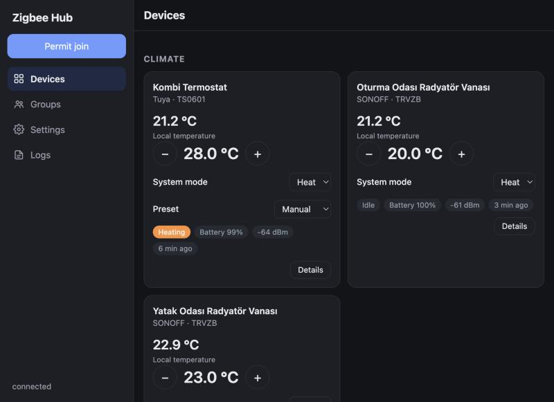
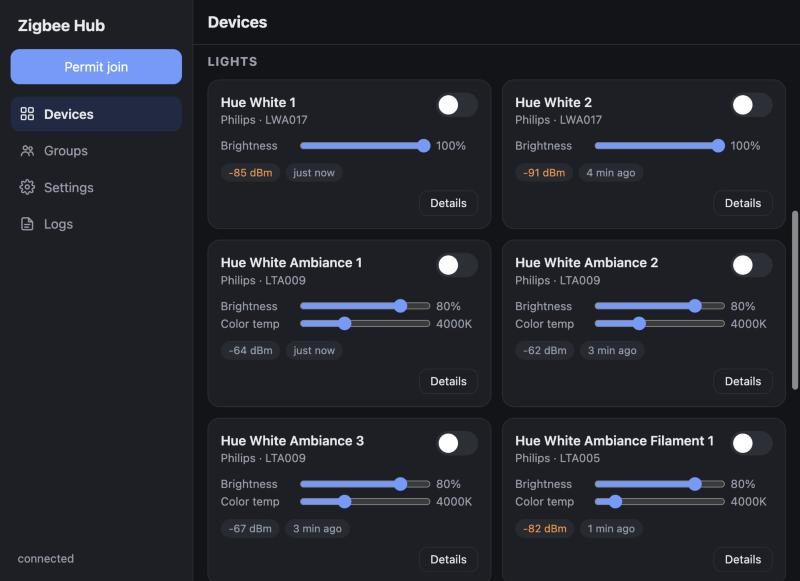
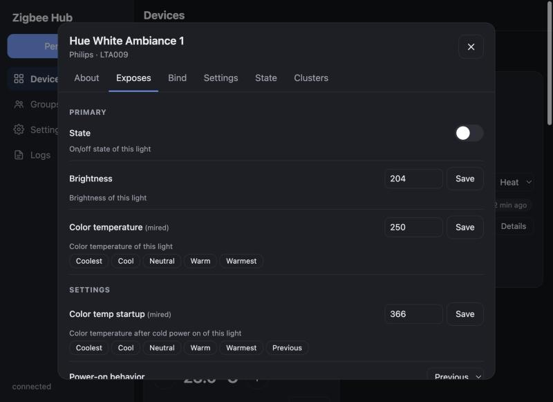
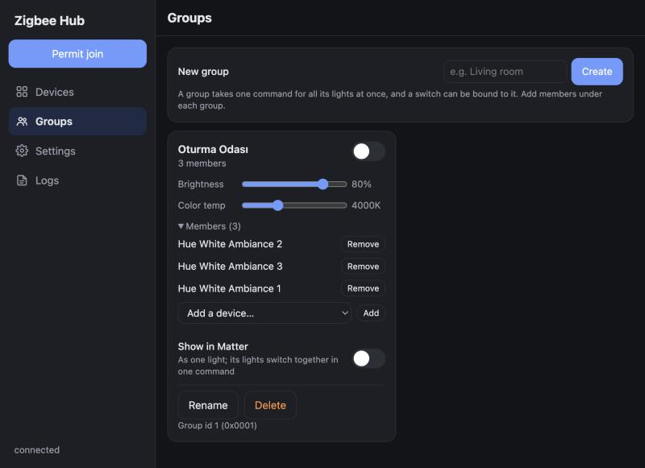
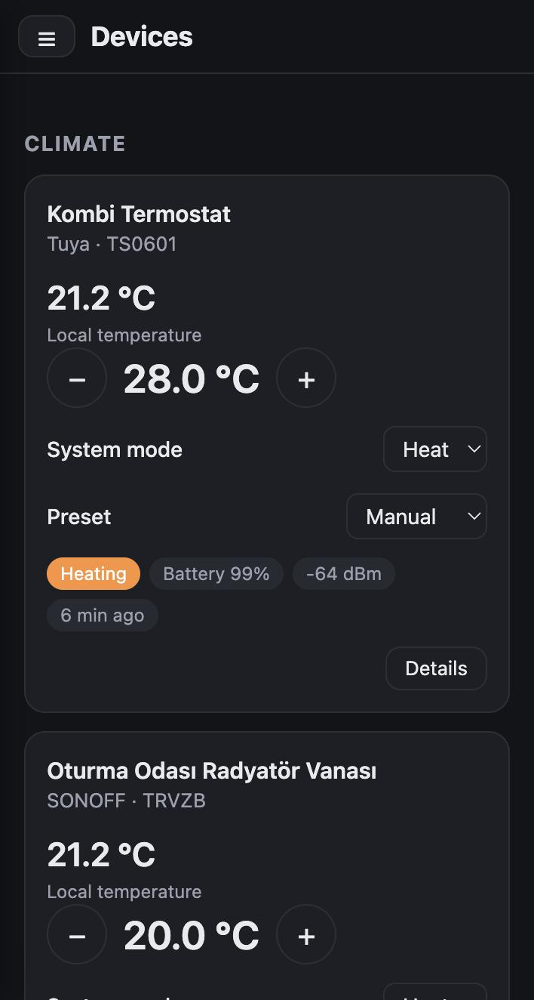

# zhub

A lightweight Zigbee hub built on the [Ziggurat](https://github.com/zigpy/ziggurat) Zigbee
stack: a single static binary with an embedded web UI, small enough to run on a router. It
was developed on a Keenetic router (MIPS) and should run on any Linux system with an
OpenThread RCP dongle (e.g. a Raspberry Pi), though only Keenetic has been tested. No Home
Assistant or Zigbee2MQTT needed.

- Forms a network and keeps the network key, frame counters and stack tables in
  `/opt/var/lib/zhub/state.json`.
- Interviews joining devices (ZDO), binds their clusters to the hub and configures
  reporting.
- Lights: on/off, brightness, color temperature, startup and transition settings, effects.
- Sensors: temperature, humidity, occupancy, IAS zones (contact, motion, water), battery.
- Remotes and switch modules: button presses become the `action` value.
- Groups: lights in a Zigbee group take one multicast command (on/off, brightness,
  color temperature); membership lives on the devices (Groups cluster).
- MQTT (optional), laid out like Zigbee2MQTT: `zigbee2mqtt/<name>` state, `…/set`
  commands (also `state: ON/OFF/TOGGLE` and `brightness`), `…/action` button presses,
  `bridge/state|devices|groups`, and Home Assistant discovery (lights and groups as lights,
  thermostats as climate, settings as number/select/switch, buttons as device triggers).
  Live updates, including every button press, also stream over `/api/events`.
- Bindings: a device's binding table can be read and edited (to the hub, a device or a
  group), so e.g. a switch controls lights directly.
- Thermostats: SONOFF TRVZB (ZCL thermostat cluster) and Tuya thermostats (datapoints),
  both with weekly schedules (the TRVZB takes a schedule but cannot report it, so the UI
  shows what was saved from the hub).
- Hue lights can be factory reset by serial number (like the Hue Bridge).
- Network map: the hub and every router report their neighbor (and optionally routing)
  tables; the UI draws the mesh with link quality, and MQTT answers Zigbee2MQTT's
  `bridge/request/networkmap` (`raw`, `graphviz`, `plantuml`).
- Web UI at `http://<router>:8099`. Without a password anyone on the network can control
  every device; like Zigbee2MQTT's auth token, Settings → Web UI password protects the page
  and its API (one password, remembered per browser; kept as a salted hash). A forgotten
  password is removed by starting zhub once with `--reset-ui-password`. Do not expose the UI
  to the internet.
- Settings page: hub and radio firmware info, network parameters, transmit power,
  availability limits (cards show Offline), permit join duration, log level with a live
  log viewer, restart, Hue reset.
- Values for sleepy devices are written at once and repeated until taken; ones still
  waiting survive a restart (kept in the state file).
- Matter bridge (optional, `--features matter`): lights, thermostats and temperature
  sensors appear in Apple Home, Google Home or Home Assistant; a group can be shown as one
  light. It uses the test vendor ID, so controllers treat it as uncertified.

## Screenshots

| Devices | Lights |
|---|---|
|  |  |
| **Device details** | **Groups** |
|  |  |



## zhub and Zigbee2MQTT

zhub follows [Zigbee2MQTT](https://www.zigbee2mqtt.io/)'s device model and MQTT interface, but
is built for a smaller machine. Zigbee2MQTT is the mature choice with far wider device
support; zhub trades that for a footprint that fits on a router.

| | zhub | Zigbee2MQTT |
|---|---|---|
| Runtime | One static binary (Rust), no runtime to install | Node.js (22 or later) application with npm dependencies |
| Size | 4.1 MB, or 6.0 MB with the Matter bridge (MIPS build) | npm package 1.6 MB plus 19 dependencies and Node.js; Docker image about 48 MB compressed |
| Memory | 6.2 MB resident, 15 devices, with Matter (measured on the router) | about 50–60 MB in [one user's report](https://community.home-assistant.io/t/ha-ram-usage-optimization/535105) (Raspberry Pi 4, 21 devices) |
| Hardware | Router-class devices; developed on a Keenetic (MIPS 1004Kc, 256 MB RAM) | Raspberry Pi, PC, NAS, Docker: anywhere Node.js runs |
| Zigbee stack | [Ziggurat](https://github.com/zigpy/ziggurat) on the host; the dongle is only a radio | [zigbee-herdsman](https://github.com/Koenkk/zigbee-herdsman); the stack runs on the adapter |
| Adapter firmware | OpenThread RCP (Spinel) on Silicon Labs EFR32, e.g. SONOFF ZBDongle-E | EmberZNet (Silicon Labs), Z-Stack (Texas Instruments), deCONZ (Dresden Elektronik); ZiGate, ZBOSS |
| Network data | Kept by the host (`state.json`): reflashing or replacing the dongle needs no re-pairing | Kept on the adapter; backup and restore when changing adapters |
| Supported devices | 9 models defined; others get a generic definition from their clusters | 5,798 devices from 608 vendors |
| Web UI | Built in | Built in (separate frontend package) |
| MQTT | Optional; Zigbee2MQTT topics, payloads and Home Assistant discovery | Required; the main interface |
| Matter | Built-in bridge (optional build feature) | Not built in |
| Groups and bindings | Yes | Yes, plus scenes and reporting configuration |
| OTA firmware updates | No | Yes |
| Network map | Yes (web UI and MQTT: raw, Graphviz, PlantUML) | Yes |
| Touchlink | Hue factory reset by serial number | Scan, identify and factory reset |
| UI password | Yes (one password) | Yes (auth token) |
| Maturity | New; used in one home | Mature, large community |
| License | Apache-2.0 | GPL-3.0 |

## Architecture

Following Zigbee2MQTT: the hub knows no device types; devices are defined as data under
`src/devices/`.

- **Definition**: fingerprint (model or manufacturer name), vendor and description,
  card layout, features, extra bindings, time base.
- **Feature**: key, label, description, kind (numeric/binary/enum/schedule), access,
  where it shows in the UI, and its source (a ZCL attribute, a light command or a Tuya
  datapoint). Decoding, writing and the UI schema all come from the same definition.
- **Common building blocks** (`devices/common.rs`): features of the standard clusters;
  devices without a definition get one built from the clusters they offer.
- Configuration (binding, reporting, reads) is derived from the features; writes to
  sleepy devices are queued and performed when the device wakes up.

Adding a device: open its definition in Zigbee2MQTT (`zigbee-herdsman-converters`),
write the same information as a `Definition` in `devices/<vendor>.rs` and add it to the
list in `devices/mod.rs`. Feature labels and descriptions are taken from Zigbee2MQTT.

Defined devices: Philips Hue LTA005, LTA009, LWA017, RDM001/RDM004 (wall switch module), SONOFF SNZB-02D,
SNZB-02P, TRVZB, Tuya ZWT07 (`_TZE200_g9a3awaj`).

## Hardware

SONOFF ZBDongle-E ("Zigbee 3.0 USB Dongle Plus V2", EFR32MG21) with Nerivec's OpenThread
RCP build `sonoff_zbdonglee_openthread_rcp_2026.6.2_3.1.2_460800_sw_flow.gbl`: 460800 baud,
XON/XOFF flow control (`--baudrate 460800 --flow-control software`; both must match the
firmware build). On Keenetic the "USB to Serial Port Converters" component must be
installed. The dongle is a USB 2.0 device; a USB 3 port only adds 2.4 GHz noise.

Other Linux systems: build for the target (`cargo build --release`, or `--features matter`)
and pass the dongle's serial port, baud rate and flow control. The Matter bridge announces
itself through Avahi static service files in `/tmp/avahi/services`, where Keenetic's Avahi
reads them; elsewhere that directory has to be one the local Avahi watches.

Known issue: some sleepy devices (SONOFF TRVZB) cannot join the dongle directly with a
MAC association; pair them through a router (e.g. a Hue light). After that they can
rejoin the dongle directly.

## Build and install

`./build.sh` builds in Docker. `./build-native.sh` builds on the host instead (Rust nightly
via rustup, zig 0.15.2 in `.tools/`); it is faster and is the one that fits the Matter build
(rs-matter needs more memory than Docker Desktop's default VM gives).

```sh
./build.sh
cat target/mips-unknown-linux-musl/release/zhub | ssh -p 222 root@192.168.1.1 'cat > /opt/bin/zhub && chmod +x /opt/bin/zhub'
cat deploy/S99zhub | ssh -p 222 root@192.168.1.1 'cat > /opt/etc/init.d/S99zhub && chmod +x /opt/etc/init.d/S99zhub'
ssh -p 222 root@192.168.1.1 /opt/etc/init.d/S99zhub restart
```

MQTT broker on the router (optional; Home Assistant or another automation platform connects
to it): Entware's `mosquitto-nossl` (no TLS, ~110 KB) with `deploy/mosquitto.conf`, which
listens on the home network and localhost only and requires a password. This build stores
passwords in plain text, so the file is readable by the broker user only:

```sh
opkg install mosquitto-nossl
cat deploy/mosquitto.conf | ssh -p 222 root@192.168.1.1 'cat > /opt/etc/mosquitto/mosquitto.conf'
# on the router: one line per user, "name:password"
mkdir -p /opt/var/lib/mosquitto && chown nobody:nobody /opt/var/lib/mosquitto
umask 077; echo "zhub:<password>" > /opt/etc/mosquitto/passwd; chown nobody:nobody /opt/etc/mosquitto/passwd
/opt/etc/init.d/S80mosquitto restart
```

Then Settings → MQTT in zhub: broker 127.0.0.1, user zhub.

Log: `/opt/var/log/zhub.log`. `--sniff` logs MAC command frames for diagnostics (the
radio does not acknowledge frames while sniffing; use it only briefly).

## Credits

zhub builds on the work of these projects:

- [Ziggurat](https://github.com/zigpy/ziggurat) (Apache-2.0): the Zigbee stack zhub runs
  on, from the zigpy project. `vendor/ziggurat-spinel` is a modified copy of its Spinel
  client (see `vendor/ziggurat-spinel/ZHUB-CHANGES.md`).
- [rs-matter](https://github.com/project-chip/rs-matter) (Apache-2.0): the Rust Matter
  stack behind the Matter bridge.
- [Zigbee2MQTT](https://github.com/Koenkk/zigbee2mqtt) and
  [zigbee-herdsman-converters](https://github.com/Koenkk/zigbee-herdsman-converters) (MIT) by
  Koen Kanters and contributors: the device definitions, feature names and descriptions, and
  the light command behavior are derived from zigbee-herdsman-converters; the MQTT topics
  and payloads follow Zigbee2MQTT so that tools made for it work with zhub.
- [Nerivec's silabs-firmware-builder](https://github.com/Nerivec/silabs-firmware-builder):
  the OpenThread RCP firmware zhub is tested with.

## License

Apache License 2.0, see [LICENSE](LICENSE). Third-party notices are in [NOTICE](NOTICE).
